# Block diagram

> Generated by `arch/build.py` from `arch/lcu_h12.json`. Do not edit by hand.

```mermaid
flowchart TB
    accTitle: LCU_H12 system architecture
    accDescr: Blocks and interfaces of the LCU_H12 board, grouped by subsystem.
    subgraph G_Power["Power"]
        pwr[("<b>Power supply</b><br/><i>VIN to the LCU rails</i>")]
    end
    subgraph G_Compute["Compute"]
        direction LR
        mcu_master[["<b>Master MCU</b><br/><i>Ethernet, SD, LPU supervision</i>"]]
        mcu_slave[["<b>Slave MCU</b><br/><i>500 us loop, ADC, PWM</i>"]]
    end
    subgraph G_Communications["Communications"]
        direction LR
        eth["<b>Ethernet PHY</b><br/><i>KSZ8041TLI, RMII</i>"]
        sd["<b>microSD</b><br/><i>SDMMC1 4-bit</i>"]
        can["<b>CAN transceiver</b> ×2<br/><i>TJA1051T/3, one per MCU</i>"]
        if_eth[/"<b>Ethernet connector</b><br/><i>RJ45 with magnetics</i>"/]
    end
    subgraph G_LPU_interface["LPU interface"]
        direction LR
        lpu_buf["<b>PWM buffer bank</b> ×10<br/><i>SN74AHCT367, 5 V</i>"]
        lpu_conn[/"<b>LPU connector</b> ×10<br/><i>TE 5499922-6, 26 pins</i>"/]
    end
    subgraph G_Airgap_sensing["Airgap sensing"]
        direction LR
        agp_afe{{"<b>Airgap analog front end</b> ×8<br/><i>4-20 mA into MCP6022</i>"}}
        agp_conn[/"<b>Airgap connector</b> ×8<br/><i>Micro-Fit+, 4 pins</i>"/]
    end
    subgraph G_Temperature["Temperature"]
        direction LR
        tmp{{"<b>LPU temperature front end</b> ×10<br/><i>NTC, 220 ohm + 10 nF</i>"}}
        if_ntc[/"<b>Corner NTC connectors</b> ×4<br/><i>direct to the pod corners</i>"/]
        ntc_afe{{"<b>Corner NTC front end</b> ×4<br/><i>excitation + RC + TVS</i>"}}
    end
    subgraph G_Safety["Safety"]
        direction LR
        lpu_rst_logic["<b>brake fault -> buffer enable override</b><br/><i>hardware release of the 5 V bank</i>"]
        brake_conn[/"<b>brake_fault input connector</b> ×2<br/><i>daisy chain, in and out</i>"/]
    end
    subgraph G_Auxiliary["Auxiliary"]
        direction LR
        leds["<b>Status LEDs</b><br/><i>board and per-LPU</i>"]
        imu{{"<b>IMU (optional)</b><br/><i>optional, unpopulated</i>"}}
        dbg["<b>Debug</b> ×2<br/><i>SWD</i>"]
    end
    pwr -->|"+3V3M"| mcu_master
    pwr -->|"+3V3M"| mcu_slave
    pwr -->|"+5V_LCU"| lpu_buf
    pwr -->|"+3V3 analog"| agp_afe
    mcu_master ==>|"SPI3 control, M to S"| mcu_slave
    mcu_slave ==>|"SPI1 telemetry, S to M"| mcu_master
    mcu_master -->|"NRST + FAULT"| mcu_slave
    mcu_master -->|"RMII"| eth
    eth -->|"MDI"| if_eth
    mcu_master -->|"SDMMC1"| sd
    mcu_master -->|"FDCAN1"| can
    mcu_slave -->|"FDCAN1"| can
    mcu_slave -->|"20 PWM @ 20 kHz"| lpu_buf
    lpu_buf -->|"PWM x2 + buffer enable"| lpu_conn
    lpu_conn -->|"SHUNT"| mcu_slave
    lpu_conn -->|"VBAT"| mcu_master
    lpu_conn -->|"TEMP"| tmp
    tmp -->|"0-3.3 V"| mcu_master
    lpu_conn -->|"READY / FAULT"| mcu_master
    mcu_master -->|"RESET x10 into the buffer"| lpu_conn
    brake_conn -->|"brake_fault"| lpu_rst_logic
    lpu_rst_logic -->|"RESET through the 5 V bank"| lpu_conn
    agp_conn -->|"4-20 mA"| agp_afe
    agp_afe -->|"0.64-3.2 V, 16 bit"| mcu_slave
    if_ntc -->|"NTC x4"| ntc_afe
    ntc_afe -->|"0-3.3 V"| mcu_slave
    mcu_master -->|"GPIO"| leds
    mcu_master -.->|"SPI, optional"| imu
    mcu_master -->|"SWD"| dbg
    mcu_slave -->|"SWD"| dbg
    classDef power fill:#eceff1,stroke:#607d8b,stroke-width:2px,color:#263238
    classDef mcu fill:#d6e4f0,stroke:#2f5d8a,stroke-width:2px,color:#102538
    classDef comms fill:#dcecd9,stroke:#4f7f43,stroke-width:2px,color:#1e2b16
    classDef conn fill:#fdf0cf,stroke:#b8860b,stroke-width:2px,color:#3a2c02
    classDef driver fill:#efe4f7,stroke:#7a4f96,stroke-width:2px,color:#2a1633
    classDef analog fill:#e7e0f2,stroke:#6a5aa0,stroke-width:2px,color:#221c38
    classDef logic fill:#fbe0e0,stroke:#a14b4b,stroke-width:2px,color:#3a1414
    classDef aux fill:#eceff1,stroke:#9097a0,stroke-width:1px,color:#2b2f33
    class pwr power
    class mcu_master mcu
    class mcu_slave mcu
    class eth comms
    class sd comms
    class can comms
    class lpu_buf driver
    class lpu_conn conn
    class agp_afe analog
    class agp_conn conn
    class tmp analog
    class lpu_rst_logic logic
    class brake_conn conn
    class leds aux
    class imu analog
    class dbg aux
    class if_eth conn
    class if_ntc conn
    class ntc_afe analog
```

### Reading the diagram

| Shape | Means |
|---|---|
| Double border | MCU |
| Parallelogram | Off-board connector |
| Hexagon | Analog front end |
| Cylinder | Power supply |
| Stadium / box | Everything else |

Thick arrows are the two SPI links between the MCUs — the backbone of the board.
Dashed arrows are optional parts that may not be populated.

| Colour | Group |
|---|---|
| Blue | Compute |
| Green | Communications and storage |
| Purple | Analog front ends |
| Amber | Connectors |
| Red | Safety logic |
| Grey | Power and auxiliary |
