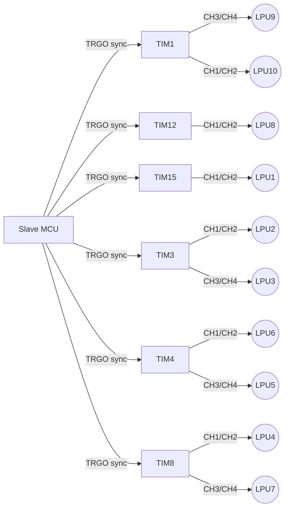

# Automated feasibility checks

> Generated by `arch/build.py` from `arch/lcu_h12.json`. Do not edit by hand.

| Status | Check | Detail |
|---|---|---|
| OK | `PIN-master` No duplicated pins | 101 pins declared |
| OK | `PIN-master-N` Pin budget | 101/114 used, 13 spare |
| OK | `ADC-master/ADC1-RANKS` Sequence ranks | 10/16 |
| OK | `ADC-master/ADC1-FADC` fADC within limits | 36 MHz <= 96 MHz at 12 bits |
| OK | `ADC-master/ADC3-RANKS` Sequence ranks | 10/16 |
| OK | `ADC-master/ADC3-FADC` fADC within limits | 36 MHz <= 96 MHz at 12 bits |
| OK | `PIN-slave` No duplicated pins | 61 pins declared |
| OK | `PIN-slave-N` Pin budget | 61/114 used, 53 spare |
| OK | `ADC-slave/ADC1-RANKS` Sequence ranks | 16/16 |
| OK | `ADC-slave/ADC1-FADC` fADC within limits | 36 MHz <= 36 MHz at 16 bits |
| OK | `ADC-slave/ADC2-RANKS` Sequence ranks | 2/16 |
| OK | `ADC-slave/ADC2-FADC` fADC within limits | 36 MHz <= 36 MHz at 16 bits |
| OK | `ADC-slave/ADC3-RANKS` Sequence ranks | 4/16 |
| OK | `ADC-slave/ADC3-FADC` fADC within limits | 96 MHz <= 96 MHz at 12 bits |
| OK | `PWM-TIM1` Channels of TIM1 | 4 used: CH1, CH2, CH3, CH4 |
| OK | `PWM-TIM12` Channels of TIM12 | 2 used: CH1, CH2 |
| OK | `PWM-TIM15` Channels of TIM15 | 2 used: CH1, CH2 |
| OK | `PWM-TIM3` Channels of TIM3 | 4 used: CH1, CH2, CH3, CH4 |
| OK | `PWM-TIM4` Channels of TIM4 | 4 used: CH1, CH2, CH3, CH4 |
| OK | `PWM-TIM8` Channels of TIM8 | 4 used: CH1, CH2, CH3, CH4 |
| OK | `PWM-LPU1` LPU1 | TIM15 CH1/CH2 |
| OK | `PWM-LPU2` LPU2 | TIM3 CH1/CH2 |
| OK | `PWM-LPU3` LPU3 | TIM3 CH3/CH4 |
| OK | `PWM-LPU4` LPU4 | TIM8 CH1/CH2 |
| OK | `PWM-LPU5` LPU5 | TIM4 CH3/CH4 |
| OK | `PWM-LPU6` LPU6 | TIM4 CH1/CH2 |
| OK | `PWM-LPU7` LPU7 | TIM8 CH3/CH4 |
| OK | `PWM-LPU8` LPU8 | TIM12 CH1/CH2 |
| OK | `PWM-LPU9` LPU9 | TIM1 CH3/CH4 |
| OK | `PWM-LPU10` LPU10 | TIM1 CH1/CH2 |
| OK | `PWM-SYNC` Advanced timer available as sync master | TIM1, TIM8 |
| OK | `ADC-PERIOD` Control period occupancy (worst ADC) | slave/ADC1: 7.6 us of 500 us (2%) |
| OK | `LINK-CONTROL-payload` Master is SPI master: frame payload | 77 B -> 36 us (7% of 500 us) |
| OK | `LINK-CONTROL-payload_and_CRC` Master is SPI master: frame payload + CRC | 81 B -> 38 us (8% of 500 us) |
| WARN | `LINK-CONTROL-H11-BASELINE` Reference: frame measured on LCU_H11 | 899 B -> 418 us (84% of the period). This link is now down to 77 B. |
| OK | `LINK-CONTROL-BAUD2` Headroom at 34.4 MHz | 81 B -> 19 us (4%) |
| OK | `LINK-CONTROL-CRC` Frame carries a CRC | 4 B |
| OK | `LINK-TELEMETRY-payload` Slave is SPI master: frame payload | 206 B -> 96 us (19% of 500 us) |
| OK | `LINK-TELEMETRY-payload_and_CRC` Slave is SPI master: frame payload + CRC | 210 B -> 98 us (20% of 500 us) |
| OK | `LINK-TELEMETRY-BAUD2` Headroom at 34.4 MHz | 210 B -> 49 us (10%) |
| OK | `LINK-TELEMETRY-CRC` Frame carries a CRC | 4 B |
| OK | `AGP-LEVEL` Conditioner output fits the ADC range | 0.64 V .. 3.20 V (full scale 3.3 V) |
| OK | `AGP-SUPPLY` Amplifier rail is within the ADC reference | 3.3 V <= 3.3 V |
| WARN | `AGP-SUPPLY-H10` Reference: the H10 front end runs at 5 V | 5.0 V amplifier into a 3.3 V ADC with nothing in between. Benign while the loop stays under 20 mA (3.2 V) -- which is exactly why it never showed up until the input saturated. |
| OK | `AGP-LIVE-ZERO` Live-zero threshold sits below the 4 mA level | threshold 0.576 V (3.6 mA) < 0.640 V: 0 mA is distinguishable from full scale |
| OK | `AGP-LSB` ADC resolution over the current loop | 50.4 uV/LSB = 0.0003 mA/LSB = 2.8 um of sensor travel |
| WARN | `AGP-ENOB` 16-bit conversion is not 16-bit accuracy | sensor linearity +/-140 um over 140 mm = 0.10% FS (~10.0 bits); H7 ADC ENOB ~13.2; 0.1% sense resistor (~10.0 bits) |
| OK | `LPU-STATUS-READY` READY pull-down lands on the fault level | un-driven = LOW = fault level |
| OK | `LPU-STATUS-FAULT` FAULT pull-down lands on the fault level | un-driven = LOW = fault level |
| OK | `LPU-STATUS-TABLE` State table is complete | 4 of 4 combinations; only 1 reads healthy, and it needs an active driver on both lines |
| OK | `MEC-LONG-EDGE` 26-pin LPU headers vs the two long edges | 445 mm of 480 mm (93%). Stacking is allowed, so this is a planning figure: five per side is the natural arrangement. |
| WARN | `MEC-SHORT-EDGE` The short edges are heavily loaded | 221 mm of 320 mm on the two short edges (69%) |
| OK | `MEC-PERIMETER` Total connector body length | 31 connectors, 666 mm of 800 mm of perimeter (83%) |
| OK | `REQ-OK` Requirements in state OK | 50 |
| OK | `REQ-AC` Requirements in state AC | 6 |
| OK | `REQ-TBD` Requirements in state TBD | 1 |
| WARN | `REQ-OPEN` Requirements still open | 6 AC + 1 TBD |
| OK | `Q-CLOSED` Questions answered | 15 of 15 |

## PWM timers

## Requirement summary

- **AC**: 6
- **OK**: 50
- **TBD**: 1
